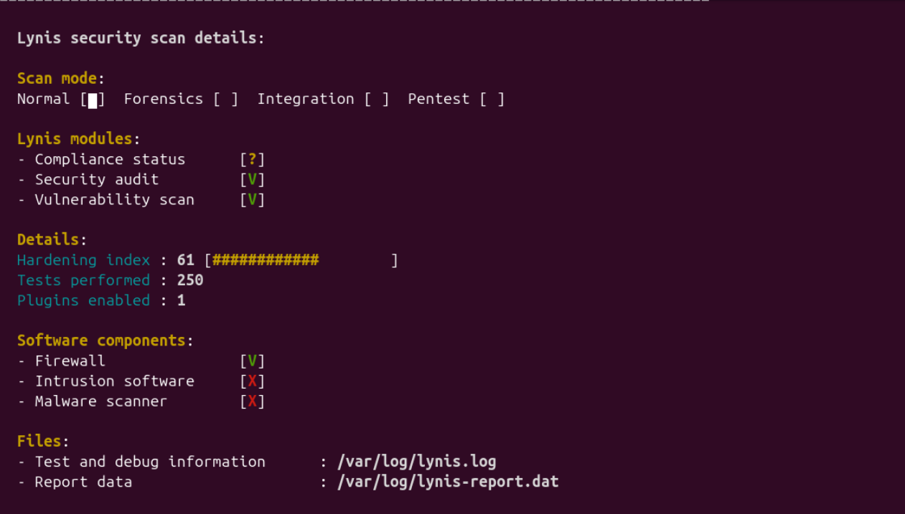
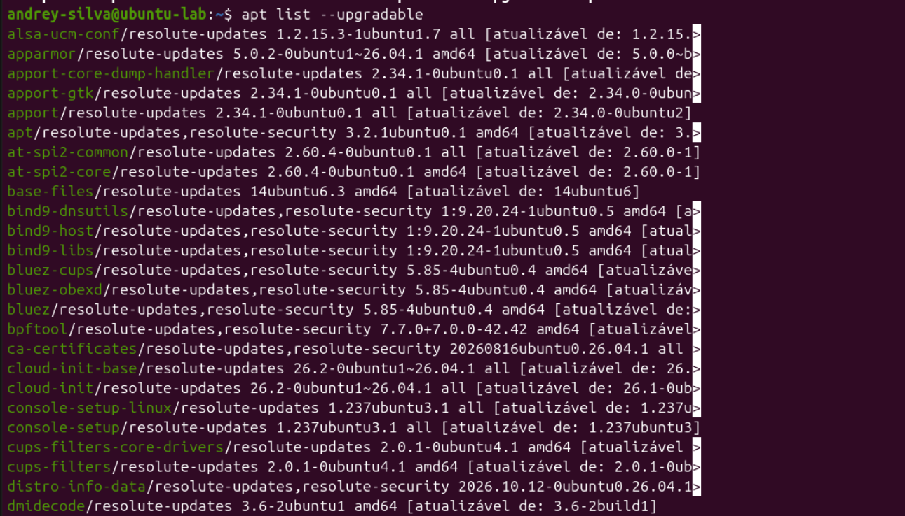
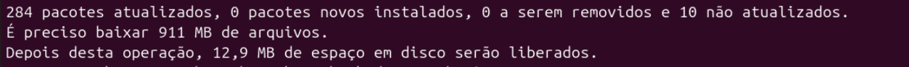
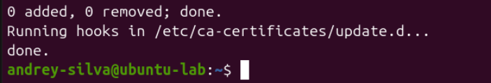
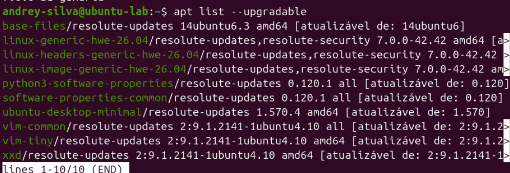
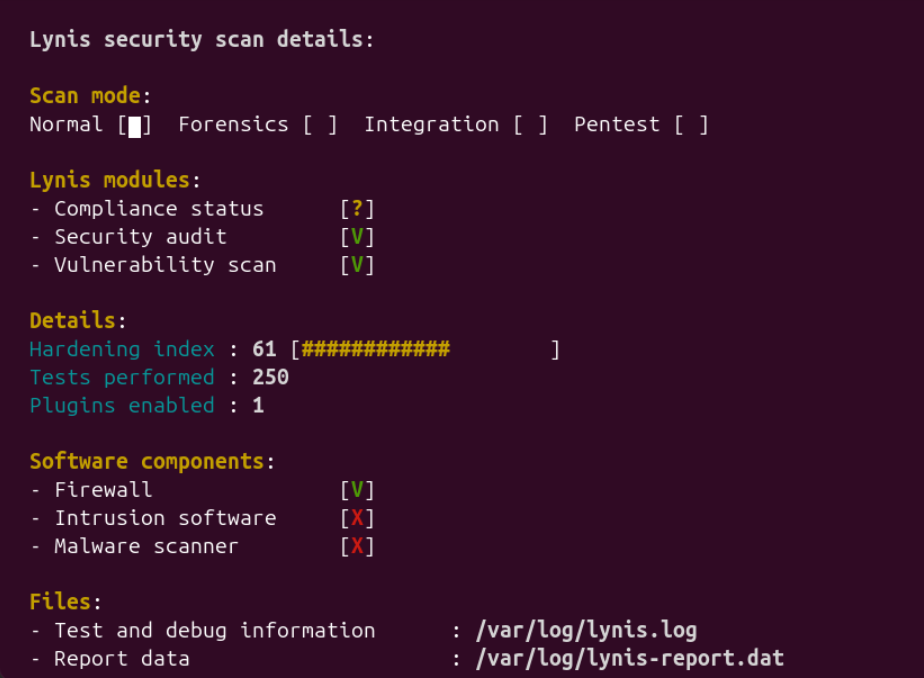
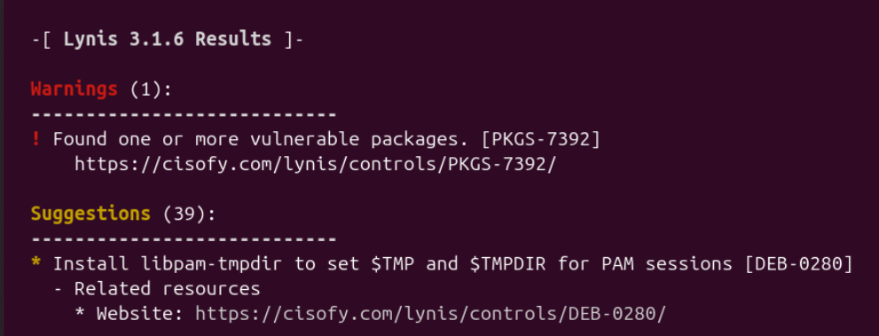
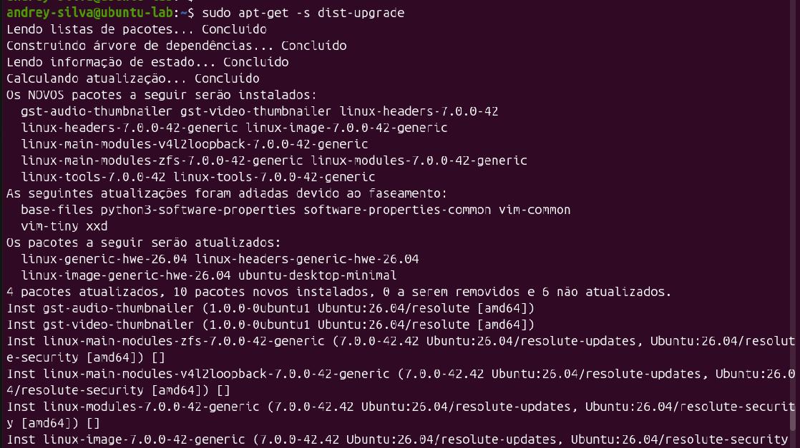
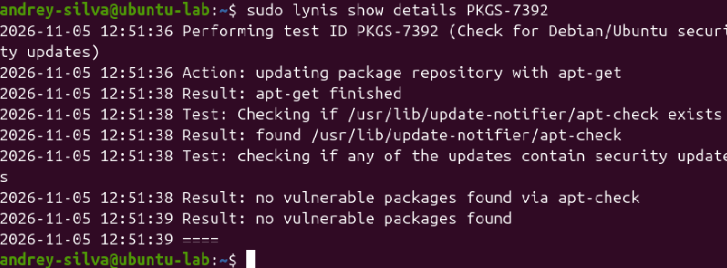
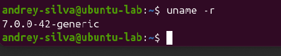

# 🔐 LAB 01 — Auditoria de Segurança com Lynis

**Projeto:** Security Labs  
**Área:** Segurança da Informação  
**Sistema operacional:** Ubuntu 26.04  
**Ambiente:** VMware Workstation  
**Ferramenta:** Lynis 3.1.6  
**Data:** 05/11/2026  
**Status:** Concluído ✅

---

## 📌 1. Objetivo

Realizar uma auditoria de segurança em um sistema Linux utilizando a ferramenta Lynis, identificando possíveis vulnerabilidades, configurações inseguras e atualizações pendentes.

O laboratório também tem como objetivo aplicar medidas de remediação e comparar os resultados obtidos antes e depois das correções.

### Competências desenvolvidas

- Auditoria de segurança em sistemas Linux;
- Identificação de vulnerabilidades e riscos;
- Gerenciamento de atualizações de segurança;
- Análise de relatórios técnicos;
- Remediação de problemas identificados;
- Validação das correções aplicadas.

---

## 🖥️ 2. Ambiente do laboratório

| Componente | Descrição |
|---|---|
| Sistema operacional | Ubuntu 26.04 |
| Virtualização | VMware Workstation |
| Ferramenta de auditoria | Lynis 3.1.6 |
| Gerenciador de pacotes | APT |
| Kernel inicial | 7.0.0-31-generic |
| Kernel final | 7.0.0-42-generic |

O laboratório foi realizado em uma máquina virtual Ubuntu, permitindo a execução de auditorias e atualizações em um ambiente de testes controlado.

---

## 🔎 3. Auditoria inicial de segurança

A primeira etapa consistiu na execução de uma auditoria de segurança utilizando o Lynis.

### Comando utilizado

```bash
sudo lynis audit system --quick
```

A ferramenta realizou verificações relacionadas a:

- Configurações do sistema operacional;
- Usuários e autenticação;
- Permissões de arquivos;
- Serviços em execução;
- Segurança do kernel;
- Firewall;
- Pacotes e atualizações;
- Mecanismos de proteção e monitoramento.

### Resultado inicial

| Indicador | Resultado |
|---|---|
| Hardening Index | 61 |
| Testes realizados | 250 |
| Alertas (Warnings) | 1 |
| Recomendações (Suggestions) | 39 |

O principal alerta identificado foi:

**PKGS-7392 — Found one or more vulnerable packages**

Esse alerta indicava a existência de pacotes com atualizações de segurança pendentes.

### Evidência 01 — Auditoria inicial



---

## 📦 4. Identificação de atualizações pendentes

Após a auditoria inicial, foi realizada uma análise dos pacotes instalados no sistema.

### Comandos utilizados

```bash
sudo apt update
```

```bash
apt list --upgradable
```

O sistema apresentou diversos pacotes com atualizações disponíveis, incluindo componentes relacionados à segurança.

### Simulação das atualizações

Antes de executar qualquer alteração, foi utilizada a opção de simulação do APT.

```bash
sudo apt-get -s upgrade
```

### Resultado da simulação

| Operação | Quantidade |
|---|---|
| Pacotes a atualizar | 284 |
| Novos pacotes | 0 |
| Pacotes a remover | 0 |
| Pacotes não atualizados | 10 |

A simulação permitiu avaliar previamente as alterações propostas pelo gerenciador de pacotes.

### Evidências

**02 — Pacotes pendentes de atualização**



**03 — Simulação da atualização**



---

## 🛠️ 5. Primeira etapa de remediação

Após a análise da simulação, foi executada a atualização dos pacotes disponíveis.

### Comando utilizado

```bash
sudo apt-get upgrade
```

O comando foi utilizado para aplicar as atualizações permitidas pelo APT.

Após essa etapa, uma nova auditoria foi executada com o Lynis.

Entretanto, o resultado permaneceu em:

- Hardening Index: 61;
- Warnings: 1;
- Suggestions: 39.

O alerta PKGS-7392 continuou presente, demonstrando que ainda existiam atualizações de segurança pendentes.

### Evidências

**04 — Encerramento da atualização**



**05 — Versão inicial do kernel**


**06 — Pacotes restantes após a atualização**



---

## ⚠️ 6. Investigação do alerta PKGS-7392

Para investigar a permanência do alerta, foi utilizado o comando:

```bash
sudo lynis show details PKGS-7392
```

O Lynis identificou inicialmente 11 atualizações de segurança pendentes.

Após a primeira rodada de correções, ainda existiam atualizações relacionadas ao kernel e a outros componentes do sistema.

### Auditoria intermediária

O Hardening Index permaneceu em 61, e o alerta continuou sendo apresentado.

### Evidências

**07 — Auditoria intermediária**



**08 — Alerta de segurança persistente**



---

## 🔄 7. Atualização do kernel Linux

A investigação identificou atualizações pendentes relacionadas ao kernel Linux.

Foi realizada uma nova simulação:

```bash
sudo apt-get -s dist-upgrade
```

### Resultado

| Operação | Quantidade |
|---|---|
| Pacotes a atualizar | 4 |
| Novos pacotes | 10 |
| Pacotes a remover | 0 |
| Atualizações adiadas | 6 |

Entre os novos pacotes estavam componentes do kernel Linux 7.0.0-42.

Após a análise, foi executado:

```bash
sudo apt-get dist-upgrade
```

Em seguida, a máquina virtual foi reiniciada para carregar o kernel atualizado.

### Evidência 09 — Simulação da atualização do kernel



---

## ✅ 8. Correção final e validação

Após a atualização do kernel, uma nova investigação com Lynis identificou apenas uma atualização de segurança pendente.

O pacote identificado foi:

**ca-certificates**

Foi realizada sua atualização utilizando:

```bash
sudo apt install --only-upgrade ca-certificates
```

Posteriormente, o controle PKGS-7392 foi verificado novamente.

```bash
sudo lynis show details PKGS-7392
```

### Resultado obtido

```text
Result: no vulnerable packages found via apt-check
Result: no vulnerable packages found
```

O resultado demonstrou que o controle PKGS-7392 não identificou mais pacotes vulneráveis associados às atualizações de segurança verificadas.

### Evidência 10 — Validação da correção



---

## 📊 9. Comparação dos resultados

Após as medidas de remediação, uma nova auditoria foi realizada.

```bash
sudo lynis audit system --quick
```

### Antes e depois

| Indicador | Antes | Depois |
|---|---|---|
| Hardening Index | 61 | 67 |
| Testes realizados | 250 | 250 |
| Atualizações de segurança identificadas | 11 | 0 |
| PKGS-7392 | Alerta identificado | Nenhum pacote vulnerável detectado pelo teste |
| Kernel | 7.0.0-31 | 7.0.0-42 |

### Resultado principal

**O Hardening Index aumentou de 61 para 67 pontos.**

A melhoria foi obtida após a aplicação de atualizações do sistema operacional, incluindo componentes do kernel e certificados de segurança.

### Evidência 11 — Resultado final da auditoria


### Evidência 12 — Kernel atualizado

O kernel em execução foi verificado utilizando:

```bash
uname -r
```

Resultado:

```text
7.0.0-42-generic
```



---

## 📁 10. Evidências do laboratório

As evidências foram organizadas em ordem cronológica para facilitar a análise e a reprodução do procedimento.

| Nº | Evidência |
|---|---|
| 01 | [Auditoria inicial do Lynis](evidencias/01-auditoria-inicial-lynis-61.png) |
| 02 | [Pacotes pendentes](evidencias/02-pacotes-pendentes-antes.png) |
| 03 | [Simulação da primeira atualização](evidencias/03-simulacao-upgrade-284-pacotes.png) |
| 04 | [Encerramento da atualização](evidencias/04-termino-atualizacao-pacotes.png) |
| 05 | [Kernel inicial](evidencias/05-kernel-inicial-7.0.0-31.png) |
| 06 | [Pacotes restantes](evidencias/06-pacotes-restantes-apos-upgrade.png) |
| 07 | [Auditoria intermediária](evidencias/07-segunda-auditoria-lynis-61.png) |
| 08 | [Alerta PKGS-7392](evidencias/08-alerta-pkgs-7392-antes-remediacao.png) |
| 09 | [Simulação da atualização do kernel](evidencias/09-simulacao-upgrade-kernel-7.0.0-42.png) |
| 10 | [Validação sem pacotes vulneráveis](evidencias/10-validacao-sem-pacotes-vulneraveis.png) |
| 11 | [Hardening Index final](evidencias/11-hardening-index-final-67.png) |
| 12 | [Kernel atualizado](evidencias/12-kernel-atualizado-7.0.0-42.png) |

---

## 🧠 11. Conhecimentos adquiridos

Durante o laboratório, foram desenvolvidas habilidades práticas relacionadas à auditoria e à manutenção da segurança de sistemas Linux.

Os principais aprendizados foram:

- Utilização do Lynis para auditorias;
- Interpretação de alertas e recomendações;
- Identificação de atualizações de segurança;
- Simulação de alterações antes da execução;
- Gerenciamento de atualizações de pacotes;
- Atualização do kernel Linux;
- Investigação e validação de correções;
- Comparação de resultados antes e depois da remediação.

O laboratório demonstrou a importância de validar as correções realizadas, pois a primeira atualização não eliminou todas as pendências identificadas.

---

## 📝 12. Considerações finais

O objetivo principal do laboratório foi alcançado.

A auditoria inicial identificou configurações que exigiam atenção e atualizações de segurança pendentes.

Após a investigação e a aplicação das correções, foi possível aumentar o Hardening Index de 61 para 67 pontos e eliminar o alerta de pacotes vulneráveis no controle PKGS-7392.

É importante destacar que o Hardening Index representa uma métrica de fortalecimento do sistema, não uma porcentagem absoluta de segurança.

Da mesma forma, a ausência de pacotes vulneráveis no teste PKGS-7392 não significa que o sistema esteja livre de todas as vulnerabilidades.

O Lynis também apresentou um aviso sobre sua própria versão estar desatualizada, ponto que deve ser considerado em auditorias futuras.

Os demais mecanismos de proteção, controle de acesso e monitoramento serão abordados nos próximos laboratórios do projeto Security Labs.

---

## 📚 Referências

- [Lynis — Site oficial](https://cisofy.com/lynis/)
- [Lynis — GitHub oficial](https://github.com/CISOfy/lynis)
- [Ubuntu — Security](https://ubuntu.com/security)
- [Documentação oficial do Ubuntu](https://documentation.ubuntu.com/)

---

**Security Labs | Laboratório 01/07 — Concluído ✅**
